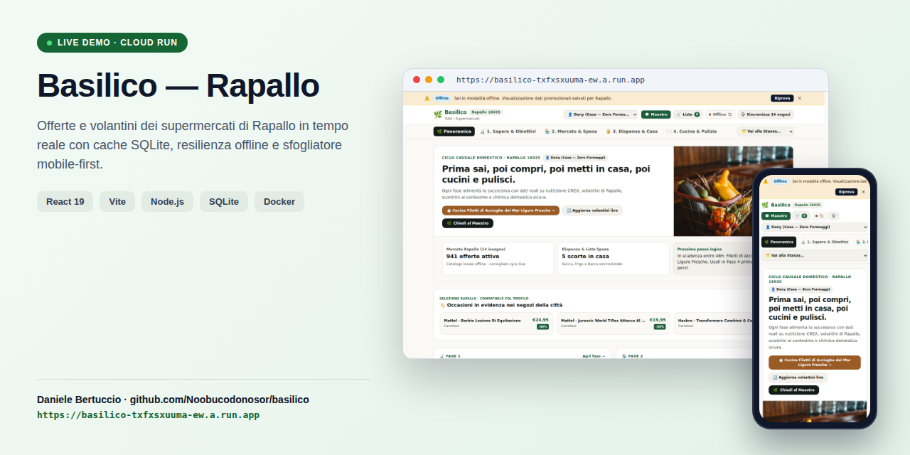

# Basilico — Offerte & Volantini Rapallo (GE)

[](https://basilico-txfxsxuuma-ew.a.run.app)

**Demo Live (Cloud Run):** [https://basilico-txfxsxuuma-ew.a.run.app](https://basilico-txfxsxuuma-ew.a.run.app)

Applicazione web full-stack responsive per consultare in tempo reale (e con resilienza offline) offerte promozionali e volantini dei supermercati di **Rapallo (GE)**, sviluppata con architettura **ADR-Driven**.

## Funzionalità Principali
- **Multi-tier Ingestion & Resilienza Offline:** connettore live + cache persistente locale JSON atomica su disco con TTL e stale grace period + dataset seed offline integrato (`data/seed/`) per garantire disponibilità costante anche in assenza di rete.
- **API REST Express:** ricerca full-text insensibile agli accenti, filtri per i 14 punti vendita reali di Rapallo (Coop, Carrefour, Basko, Gulliver, Ekom, Penny, Eurospin, Despar, DPiù, Tigotà, PiùMe, Unieuro, Arcaplanet), categoria, prezzo e sconto (`/api/stores`, `/api/offers`, `/api/flyers`, `/api/status`).
- **Interfaccia Responsive Mobile-First & PWA:** React 19 + Vite + Tailwind CSS con layout editoriale (`Oggi | Offerte | Ricette | Lista + Altro`), sfogliatore volantini nativo `<dialog>` e supporto offline `/sw.js`.
- **Containerizzazione & QA:** `Dockerfile` pronto per il deploy su Cloud Run, suite di test automatici e Domain Evals.

## Stack Tecnologico
- **Backend:** Node.js, Express, JSON Disk Cache atomica, Docker
- **Frontend:** React 19, Vite, Tailwind CSS
- **Architettura & Governance:** Architecture Decision Records in [`docs/adr/README.md`](./docs/adr/README.md) e specifica completa in [`PROJECT.md`](./PROJECT.md)

## Avvio Locale
```bash
npm install
npm start
```
