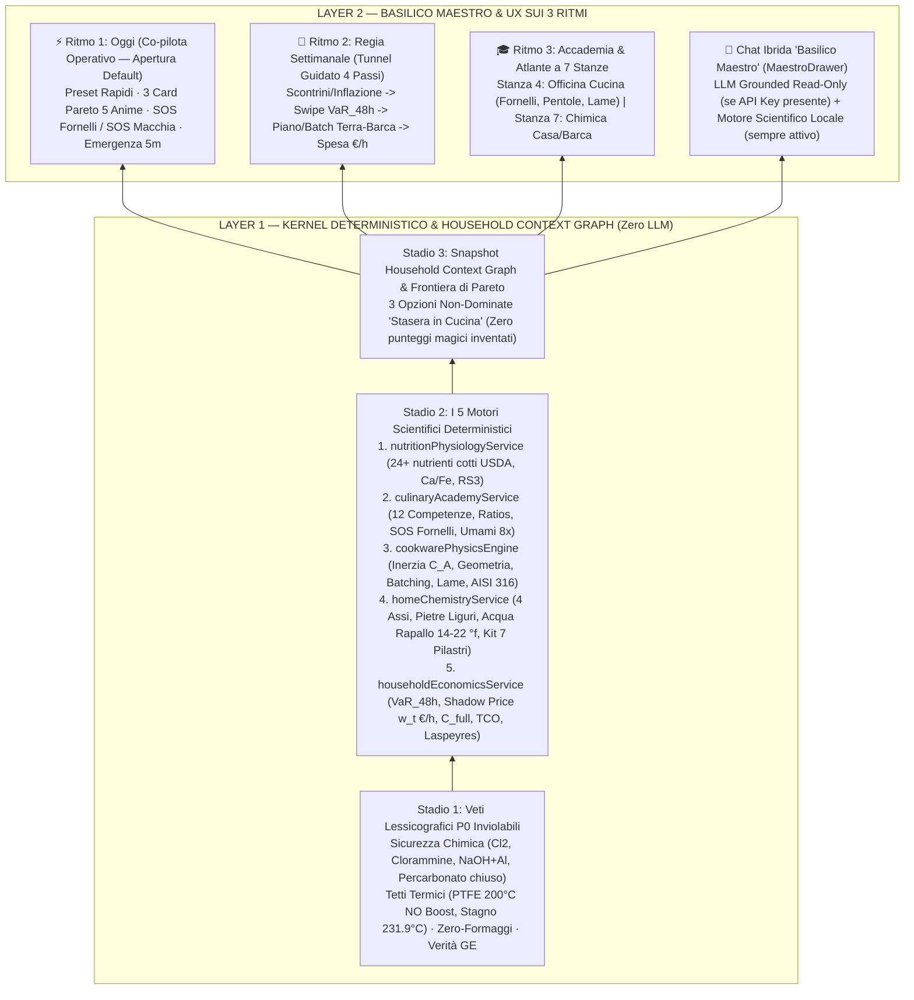

# ADR-0015: Basilico 2.0 ("Le 5 Anime") — Motore Causale Dual-Layer, Navigazione sui "3 Ritmi", Separazione Stanza 4 / Stanza 7 e Chat Ibrida Grounded col Maestro

- **Stato:** Accettato (`Accepted`)
- **Priorità:** **P0 — Critica (Evoluzione a Sistema Operativo Fisico-Economico della Casa & Sicurezza Scientifica)**
- **Data:** 2026-11-16
- **Autori:** Direttore di Prodotto (@Noobucodonosor) & Team Basilico
- **Fonti:** Contraddittorio Scientifico e Stress-Test Avversariale sulle 5 Anime (`board #7..#18`), Vincoli d'Integrità [ADR-0006](./0006-honest-data-integrity-no-synthetic-fields.md), Stack AI-Native [ADR-0014](./0014-ai-native-product-engineering-specs-evals-agentation-and-board.md)

---

## 1. Contesto e Problema

Le fondamenta deterministiche costruite a Rapallo con [ADR-0001](./0001-core-architecture.md)–[ADR-0014](./0014-ai-native-product-engineering-specs-evals-agentation-and-board.md) hanno consolidato un catalogo multi-stanza reale e verificabile, ma l'audit avversariale del codice e dell'esperienza d'uso feriale (*"Test del Martedì alle 20:30"*) ha fatto emergere **due limiti strutturali** e **quattro bug fisico-chimici concreti**:

### A. Limiti Architetturali e Cognitivi ("Effetto Silos a 6 Tab")
1. **Frammentazione delle 5 Dimensioni Reali:** Nel mondo fisico **Nutrizione**, **Arte Culinaria**, **Termofisica degli Strumenti**, **Chimica della Casa** ed **Economia Domestica** sono cinque proiezioni dello stesso identico atto quotidiano (es. cuocere delle alici in scadenza su induzione). Trattarle come tab separate impedisce al sistema di collegare il pesce in scadenza (`VaR_48h`), il limite termico del PTFE (`200°C`), l'emulsione fuori fuoco che preserva gli Omega-3 EPA/DHA, la biodisponibilità di Calcio/Ferro e il reset chimico in 45 secondi con acido citrico sulle ammine volatili.
2. **Attrito Cognitivo Feriale vs Studio Weekend:** Entrare in un gestionale a 6 tab alle 20:30 dopo una giornata di lavoro genera attrito decisionale, mentre la chimica universale della casa (bagno, marmi liguri, bucato calibrato sull'acqua di Rapallo, elettrodomestici, barca) soffocava la Stanza 4 se compressa insieme a fornelli, pentole e lame.

### B. 4 Cortocircuiti Fisico-Chimici e di Integrità Scoperti nel Codice
1. **Cortocircuito Chimico P0 su Candeggina e Acciaio Inox (`qualityLensService.js` vs `kitchenResetService.js`) + Leak Tigotà:** `qualityLensService` raggruppava `candeggina|ipoclorito` con gli sgrassatori alcalini dichiarando sicuro `Acciaio Inox 18/10` (falso chimico: $\text{NaClO}$ non saponifica i grassi e gli ioni $\text{ClO}^-/\text{Cl}^-$ innescano corrosione per *pitting* sul film passivo $\text{Cr}_2\text{O}_3$), mentre `domainClassifier.js` lasciava cadere profumi/cofanetti cosmetici Tigotà/PiùMe in `home_cleaning`.
2. **Perdita Valore Euro e `250g` Sintetici in Dispensa (`pantryService.js`):** `transferReceiptLinesToPantry` scartava `lineTotalEuro` (rendendo la dispensa cieca agli euro in scadenza) e assegnava un peso cablato `: 250` grammi alle righe scontrino prive di peso dichiarato, in violazione di [ADR-0006](./0006-honest-data-integrity-no-synthetic-fields.md).
3. **Collasso Nutrizionale a 4 Macro Crudi (`recipeAndArbitrageService.js`):** nonostante gli 832 alimenti × 26.622 valori CREA in Stanza 2, la valutazione dei piatti leggeva solo `kcal, proteine, lipidi, carboidrati` a crudo, ignorando Fibre, Calcio biodisponibile vs bloccato da ossalati (vitale per il profilo `Zero Formaggi`), Ferro + Vitamina C, EPA+DHA, ritenzione termica in cottura e aminoacidi essenziali.
4. **Cortocircuiti Termofisici Strumenti (`cookware_archetypes.json` & `recipeAndArbitrageService.js`):** ogni padella generica veniva mappata a `padella_antiaderente` PTFE (`max 200°C`) abbinandola però a `"Induzione Livello 8 / Boost 45s"` su `high` (rischio degrado termico PTFE $>260^\circ\text{C}$ in $<40\text{ s}$), mentre `pentola_rame_non_induzione` fondeva nello stesso archetipo **Rame** ($\alpha \approx 111\text{ mm}^2/\text{s}$) e **Terracotta** ($\alpha \approx 0,4\text{ mm}^2/\text{s}$, 275× di differenza fisica).

---

## 2. Decisione Architetturale

### 2.1 Architettura Causale Dual-Layer (Zero Allucinazioni, 100% Conforme `ADR-0006`)

- **Guardrail Metodologico `ADR-0006` (Bando alla Finta Precisione):** sono vietati indicatori sintetici arbitrari (es. *"€/ora di sazietà"* o percentuali chimiche puntuali inventate sui flaconi commerciali). I motori usano esclusivamente: **(a)** grandezze fisiche misurate/dichiarate (`CREA`, `NIST`, prezzi scontrino/volantino); **(b)** **Classi Discrete Certificate** con fonte esplicita (`USDA Release 6`, `SINU LARN V rev.`, `EFSA`); **(c)** **Dominanza d'Intervallo Legale** (`Reg. CE 648/2004`: fasce `<5%`, `5–15%`, `15–30%` confrontate nel caso più favorevole al prodotto commerciale contro i principi attivi puri titolati).

### 2.2 Decisioni Definitive di Prodotto & UX Approvate dal Regista

1. **Navigazione & Ingresso sui "3 Ritmi" (`⚡ Oggi` come Default):**
   - L'applicazione si apre di default su **`⚡ Oggi (Co-pilota)`** (`?rhythm=oggi`), superando il gestionale a tab nelle sere feriali: in 5 secondi mostra le **3 opzioni sulla Frontiera di Pareto** (*⚡ Minimo Attrito*, *💶 Salva-Frigo `VaR_48h`*, *👨‍🍳 Gesto da Maestro*), ciascuna con l'intera catena causale a 5 anime, i pulsanti rapidi *Ho mangiato fuori / Emergenza 5 min*, **SOS Fornelli**, **SOS Macchia 3-Tap** e **Flash Vero Sconto Rapallo**.
   - La barra superiore organizza l'esperienza nei **3 Ritmi**: **`⚡ Oggi (Co-pilota)`** · **`🧭 Regia Settimanale`** (flusso lineare in 4 passi da 10 minuti nel weekend) · **`🎓 Accademia & Atlante`**, preservando al 100% il deep-linking diretto `?room=room-1-negozi`..`room-7-chimica` per ispezione trasparente, test E2E e toolbar `Agentation`.

2. **Separazione Netta tra Stanza 4 e Stanza 7 nell'Atlante (7 Stanze Totali):**
   - **Stanza 4 — `Officina Cucina: Fornelli, Pentole, Lame & Termodinamica` (`room-4-cucina`):** focalizzata sulla fisica degli strumenti di cottura (`cookwarePhysicsEngine`), compatibilità induzione/gas, turni di rosolatura (`1 vs 2 batch`), TCO pentole (*Buy-It-For-Life* vs PTFE), metallurgia coltelli/taglieri, contenitori Casa/Barca (`Vetro borosilicato`, `Inox AISI 316` vs `PP #5`) e ROI piatti sbloccati, mantenendo il ponte contestuale rapido al *Kitchen Reset* post-cottura.
   - **Stanza 7 — `Chimica & Cura della Casa/Barca` (`room-7-chimica`):** ambiente dedicato al motore `homeChemistryService` per l'intera casa e la barca: risolutore **SOS Macchia/Sporco a 4 Assi**, **Bagno & Muffe**, **Pietre Liguri** (marmo di Carrara, ardesia, graniglia vietati a $\text{pH}<6$), **Bucato calibrato sulla durezza dell'acqua Iren di Rapallo (`14–22 °f`)**, **Manutenzione Anti-Guasto Elettrodomestici**, **Modulo Barca**, **Kit Minimo Chimico a 7 Pilastri**, **Myth-Buster stechiometrico** e arbitraggio `€/ciclo` sulle offerte di Tigotà, PiùMe e GDO.

3. **Strategia `Basilico Maestro` Ibrida fin da Subito (`maestroCoachService` + `MaestroDrawer`):**
   - Sviluppo congiunto dei 5 motori deterministici e della **Chat conversazionale col Maestro** (`POST /api/maestro/chat`), governata da un'architettura **Dual-Mode sicura**:
     - **Stadio Preliminare P0 Non Aggirabile:** intercetta deterministicamente ogni richiesta o combinazione rischiosa (miscele chimiche letali `Cl2`/clorammine, `NaOH+Al`, percarbonato chiuso in spray `P0-PRESSURE-BURST`, `PTFE + Boost`, stagno a secco, violazioni profilo `Zero Formaggi`), iniettando blocchi P0 certificati prima di qualsiasi risposta.
     - **Modalità LLM Grounded (opzionale via `process.env.GEMINI_API_KEY` o `OPENAI_API_KEY`):** usa `fetch` nativo con timeout guard (8s, zero dipendenze pesanti e zero chiavi nel codice) passando in sola lettura lo snapshot JSON certificato `buildHouseholdContextSnapshot()` e vietando all'LLM il calcolo autonomo di prezzi, kcal, LARN, limiti termici o dosaggi chimici.
     - **Motore Scientifico Deterministico Locale (sempre attivo offline, senza API key, in fallback e nei test):** analizza l'intento sulle 5 anime e genera risposte rigorose, calde e contestualizzate sui dati veri della casa in `<20ms`, dichiarando sempre con trasparenza la modalità attiva.

4. **Calibrazione Personale Dual-Tier (Preset Zero-Attrito + Sezione Avanzata Opzionale):**
   - **Livello 1 (Immediato, 1 Tap):** selettore rapido del ritmo/energia (*Sera Stanca*: $w_t = 30\text{ €/h}$, $\le 15\text{ min}$; *Feriale*: $w_t = 18\text{ €/h}$, $\le 30\text{ min}$; *Weekend / Relax*: $w_t = 8\text{ €/h}$, studio/batch cooking) + preset fisiologici base (*Adulto Attivo*, *Longevità & Leggerezza*, *Sport & Ricomposizione*, *Giornata in Barca*).
   - **Livello 2 (Avanzato Opzionale):** override puntuale di target LARN, valore orario del tempo (`hourlyValueEuro`), tariffe energetiche reali (`electricityEurPerKwh`, `gasEurPerSmc`) e pesata bilancia delle pentole ($C = M \cdot c_p$).

---

## 3. Conseguenze

- **Impatti Positivi:**
  - Risoluzione definitiva dei 4 cortocircuiti scientifici e di integrità dati (`NaClO`/Inox, leak profumi Tigotà, `250g` sintetici in dispensa, `PTFE`+Boost e fusione Rame/Terracotta).
  - Riduzione drastica del tempo decisionale feriale grazie a `⚡ Oggi` e allo *Swipe Check* da 5 secondi sul valore in scadenza (`VaR_48h`), senza sacrificare la profondità accademica delle 7 Stanze nell'Atlante.
  - Resilienza totale 100% offline e testabilità deterministica (`npm test` + `npm run eval`) anche per il Maestro conversazionale.
- **Vincoli Architetturali per Sviluppatori e Agenti:**
  - Nessuna chiave API (`GEMINI_API_KEY`, `OPENAI_API_KEY`) può mai comparire nei file sorgente, seed o test; deve essere letta esclusivamente da variabili d'ambiente runtime opzionali.
  - Ogni nuova regola fisica, nutrizionale o chimica deve rispettare `ADR-0006` (fonti ufficiali o fasce discrete certificate, `null` esplicito quando un dato non è tabellato) ed essere presidiata da rubriche automatiche in `evals/run_evals.mjs`.

---

## 4. Task Operativi Collegati

- [x] **TASK-V2-01** (`#39`): **Fix P0 Detergenza/Inox/Tigotà e Motore Chimico Universale Casa/Barca (`homeChemistryService`)**
  - *File coinvolti*: `server/services/qualityLensService.js`, `server/services/domainClassifier.js`, `data/seed/home_chemistry_matrix.json`, `server/services/homeChemistryService.js`, `server/routes/homeChemistry.js`, `tests/unit/home_chemistry_v2.test.js`
  - *Verification Step*: `node --test tests/unit/home_chemistry_v2.test.js tests/unit/domain_and_units.test.js tests/unit/kitchen_services.test.js`
- [x] **TASK-V2-02** (`#40`): **Motore Termofisico Strumenti (`cookwarePhysicsEngine`) e Accademia Culinaria / SOS Fornelli (`culinaryAcademyService`)**
  - *File coinvolti*: `data/seed/materials_physics.json`, `data/seed/cookware_archetypes.json`, `data/seed/culinary_academy.json`, `server/services/cookwarePhysicsEngine.js`, `server/services/culinaryAcademyService.js`, `server/routes/academy.js`, `tests/unit/cookware_and_academy_v2.test.js`
  - *Verification Step*: `node --test tests/unit/cookware_and_academy_v2.test.js tests/unit/kitchen_services.test.js`
- [x] **TASK-V2-03** (`#41`): **Motore Fisiologia del Pasto Cotto (24+ nutrienti, ritenzione USDA, biodisponibilità Ca/Fe, RS3) e Coaching Adattivo (`nutritionPhysiologyService`)**
  - *File coinvolti*: `data/seed/nutrition_physiology_rules.json`, `server/services/nutritionPhysiologyService.js`, `server/routes/nutritionCoach.js`, `tests/unit/nutrition_physiology_v2.test.js`
  - *Verification Step*: `node --test tests/unit/nutrition_physiology_v2.test.js tests/unit/crea_service.test.js`
- [x] **TASK-V2-04** (`#42`): **Economia Domestica (`VaR_48h`, `w_t`, TCO, `€/h`) e Motore Ibrido `maestroCoachService` (Oggi Pareto + Chat Maestro Grounded)**
  - *File coinvolti*: `server/services/pantryService.js`, `server/services/householdEconomicsService.js`, `server/services/maestroCoachService.js`, `server/routes/maestro.js`, `tests/unit/economics_and_maestro_v2.test.js`
  - *Verification Step*: `node --test tests/unit/economics_and_maestro_v2.test.js tests/unit/receipt_reconciliation.test.js tests/api/pantry_and_receipts.test.js`
- [x] **TASK-V2-05** (`#43`): **Integrazione API Backend, UI "3 Ritmi" (`⚡ Oggi`, `Regia Settimanale`, `Accademia & Atlante` a 7 Stanze) e `MaestroDrawer` Conversazionale**
  - *File coinvolti*: `server/index.js`, `server/services/recipeAndArbitrageService.js`, `src/App.jsx`, `src/components/Header.jsx`, `src/components/RoomNavigation.jsx`, `src/components/maestro/TodayCopilotView.jsx`, `src/components/maestro/WeeklyRegiaView.jsx`, `src/components/maestro/MaestroDrawer.jsx`, `src/components/chemistry/HomeChemistryView.jsx`, `src/components/kitchen/KitchenCareView.jsx`
  - *Verification Step*: `npm run build && npm test`
- [x] **TASK-V2-06** (`#44`): **Estensione Suite `Domain Evals` (`npm run eval`), Test E2E/Integrazione e Verifica Pre-Release**
  - *File coinvolti*: `evals/run_evals.mjs`, `scripts/board.mjs`, `tests/api/`, `tests/e2e/`
  - *Verification Step*: `npm run build && npm run eval && npm test && python3 ~/.gemini/config/skills/adr-github-methodology/scripts/pre_release_check.py`
