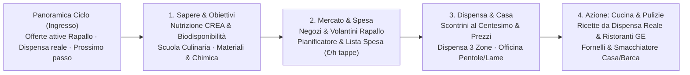

# ADR-0016: Ontologia a 4 Fasi del Ciclo Causale Domestico, Rimozione Doppia Barra Oggi/Regia & Governance Token su GitHub

- **Stato:** Accettato (`Accepted`)
- **Priorità:** **P0 — Critica (Ontologia di Prodotto, Coerenza UI Integrale & Controllo Costi/Token)**
- **Data:** 2026-11-18
- **Autori:** Direttore di Prodotto (@Noobucodonosor)
- **Supersede parzialmente:** [ADR-0015](./0015-five-souls-causal-engine-three-rhythms-and-grounded-maestro.md) §2.2 (Navigazione a "3 Ritmi / `⚡ Oggi` come ingresso" e separazione visiva `Oggi / Regia / Atlante`), preservandone integralmente §2.1 (i 5 Motori Scientifici Deterministici, le Guardie P0 e il supporto conversazionale).

---

## 1. Contesto e Problema

1. **Inversione ontologica dell'ingresso `"Oggi"`:**
   - Mettere `"Cosa cucinare stasera"` come pagina principale all'apertura di Basilico capovolge l'ordine causale reale della vita domestica: cucinare viene **dopo** aver compreso obiettivi e principi (*Sapere*), aver consultato offerte e fatto la spesa (*Mercato & Spesa*) e aver registrato ciò che è realmente entrato in casa (*Dispensa & Dotazione*).
   - La doppia barra superiore (`Oggi · Regia · Accademia & Atlante` + tendina/barra delle 7 Stanze) nascondeva inoltre le 5 stanze storiche (Negozi, CREA, Ricette, Dispensa, Pianificatore), lasciate senza restyling uniforme rispetto alle nuove schermate.
2. **Spreco di token e assenza di rendicontazione per task:**
   - L'uso di `/swarm` multi-agente sulle evoluzioni `ADR-0015` ha consumato `12.863.646` token di input nuovi, `115.890.324` token da cache e `911.622` token di output su 11 sub-agenti senza tracciabilità per singola Issue GitHub.

---

## 2. Decisione Architetturale

### 2.1 Nuova Ontologia: Le 4 Fasi del Ciclo Causale Domestico
La navigazione principale diventa un **percorso unico a 4 Fasi**, preceduto da una **Panoramica sobria d'ingresso** sullo stato reale del ciclo (offerte attive a Rapallo, scorte reali in dispensa e prossimo passo logico):

- **Eliminazione della doppia barra (`Oggi / Regia / Atlante`):** le funzioni di valore già sviluppate vengono riassorbite nella fase a cui appartengono naturalmente (`tappe €/h` dentro *Mercato & Spesa*, controllo scorte e andamento prezzi dentro *Dispensa & Casa*, proposte rapide da dispensa reale dentro *Cucina & Pulizie*), rimuovendo poi i wrapper standalone (`TASK-CICLO-06`).
- **Restyling integrale uniforme:** ciascuna fase e ciascuna delle stanze storiche (`OfferGrid`, `CreaExplorerView`, `PantryAndReceiptsView`, `RecipesAndRestaurantsView`, `PlannerAndShoppingView`) viene portata allo stesso standard editoriale caldo anti-slop (`#FAF9F6`, italiano piano, 390px/1280px).

### 2.2 Protocollo di Governance GitHub & Contabilità Esatta dei Token
1. **Regola "1 Issue = 1 Agente Singolo":** divieto di lanciare `/swarm` o sub-agenti multipli salvo richiesta esplicita del Regista. Ogni intervento procede **una sola GitHub Issue alla volta**, previa approvazione del piano da parte del Regista.
2. **Fasce Budget esplicite su GitHub (`budget:S | M | L`):**
   - `budget:S`: `<= 150.000` input nuovi (`<= 15.000` output)
   - `budget:M`: `<= 400.000` input nuovi (`<= 35.000` output)
   - `budget:L`: `<= 800.000` input nuovi (`<= 60.000` output)
3. **Misurazione automatica da `transcript.jsonl` (`scripts/tokenLedger.mjs`):**
   - Prima di iniziare: `npm run task:start -- <issue> --tier S|M|L --task TASK-...` (fissa la baseline esatta e imposta `status:in-progress` su GitHub);
   - Durante il lavoro: `npm run task:status` (mostra consumo live);
   - A fine verifica e commit: `npm run task:close -- <issue> --commit <sha> --summary "..."` (aggiorna [TOKEN_LEDGER.md](./TOKEN_LEDGER.md), pubblica automaticamente il rendiconto reale con `input_tokens`, `cache_read_tokens`, `output_tokens` e `% budget` come commento sulla GitHub Issue e passa la label a `status:taste-check`).

---

## 3. Conseguenze

- **Positive:** ordine causale intuitivo (*Prima sai -> poi compri -> poi metti in casa -> poi cucini e pulisci*), zero schermate "Oggi" vuote o fuori contesto, stile visivo finalmente uniforme su tutta l'app e controllo trasparente dei crediti per ogni singola Issue su GitHub.
- **Vincoli:** nessun file UI (`src/**`) viene modificato prima che il Regista approvi ciascuna Issue della Milestone `Ciclo Causale & Restyling Integrale (ADR-0016)`.

---

## 4. Task Operativi Collegati (Milestone #1)

- [x] **TASK-GOV-01** (`#46`): **Infrastruttura Contabilità Token Reali (`transcript.jsonl`), `ADR-0016` Ontologia a 4 Fasi e Roadmap GitHub** (`budget:S`)
  - *File coinvolti*: `scripts/tokenLedger.mjs`, `scripts/board.mjs`, `evals/run_evals.mjs`, `server/services/offerService.js`, `package.json`, `docs/adr/0016-*.md`, `docs/adr/0015-*.md`, `docs/adr/TOKEN_LEDGER.md`, `docs/adr/README.md`, `AGENTS.md`, `tests/unit/token_ledger.test.js`, `tests/integration/challenger_m2_stress.test.js`
  - *Verification Step*: `node --test tests/unit/token_ledger.test.js && npm run eval && npm test`
- [ ] **TASK-CICLO-01** (`#47`): **Nuova Navigazione Unica sulle 4 Fasi del Ciclo Causale e Panoramica d'Ingresso (rimozione doppia barra Oggi/Regia)** (`budget:M`)
- [ ] **TASK-CICLO-02** (`#48`): **Fase 1 "Sapere & Obiettivi": Restyling editoriale di Scienza & CREA e integrazione coerente con Obiettivi Nutrizionali e Scuola Culinaria** (`budget:M`)
- [ ] **TASK-CICLO-03** (`#49`): **Fase 2 "Mercato & Spesa": Restyling editoriale profondo di Negozi & Offerte Rapallo e Pianificatore/Lista Spesa (con assorbimento tappe `€/h`)** (`budget:L`)
- [ ] **TASK-CICLO-04** (`#50`): **Fase 3 "Dispensa & Dotazione Casa": Restyling editoriale di Dispensa & Scontrini (con storico prezzi reale) e Officina Strumenti** (`budget:M`)
- [ ] **TASK-CICLO-05** (`#51`): **Fase 4 "Azione: Cucina & Pulizie": Restyling editoriale di Ricette, Ristoranti GE & Fornelli (con proposte da dispensa reale) e Chimica Casa** (`budget:L`)
- [ ] **TASK-CICLO-06** (`#52`): **Pulizia codice superato (`Oggi/Regia` standalone), riallineamento Living Specs, Domain Evals e chiusura Milestone** (`budget:S`)
