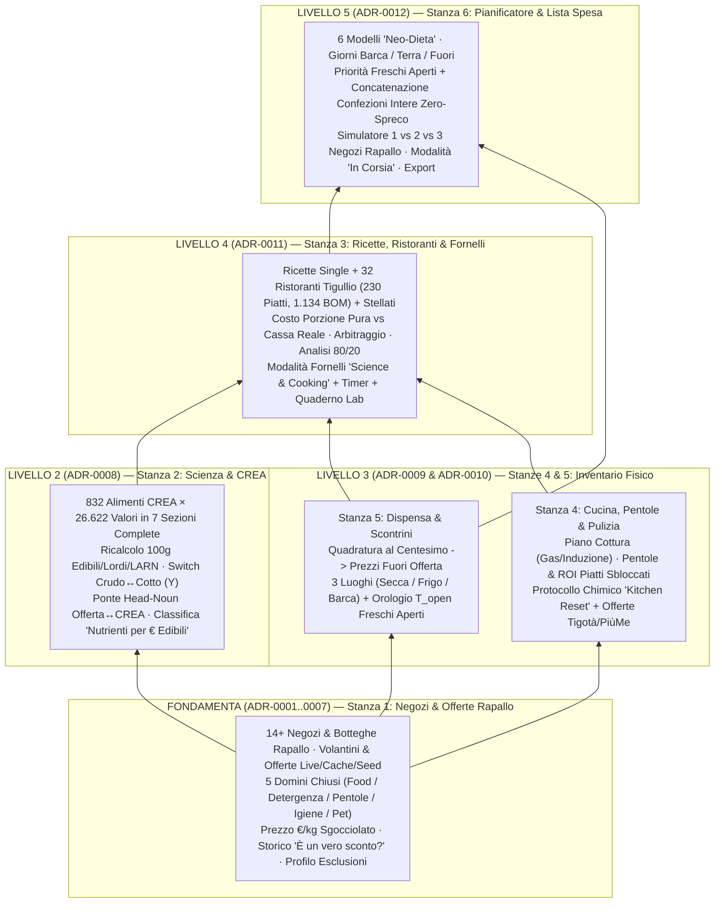

# Architecture Decision Records (ADR) & Master Task Backlog — Basilico

Questa cartella raccoglie gli **Architecture Decision Records (ADR)** e il **Backlog Operativo** del progetto **Basilico — Sistema Domestico, Nutrizionale, Gastronomico e Catalogo Offerte di Rapallo (GE)** (`Noobucodonosor/basilico`), consolidando le decisioni architetturali, di sicurezza/hardening, di interfaccia utente, di fedeltà territoriale dei dati e l'evoluzione modulare **Bottom-Up a 6 Stanze Principali**.

---

## Indice degli ADR

| ID | Titolo | Stato | Priorità | Autori / Fonti |
| :--- | :--- | :--- | :--- | :--- |
| **[ADR-0001](./0001-core-architecture.md)** | Architettura Core, Stack Tecnologico e Modello Dati Multi-Tier (Live → Cache → Seed) | Accettato (Baseline) | **P1 — Alta** | Team Basilico / `PROJECT.md` |
| **[ADR-0002](./0002-security-input-hardening.md)** | Sicurezza HTTP, Protezione Path Traversal, Input Hardening e Sanitizzazione Ricerca | Accettato | **P0 — Critica** | Team Basilico / `TEST_READY.md` |
| **[ADR-0003](./0003-responsive-ui-flyer-viewer.md)** | Interfaccia Web Responsive (375px/1280px), Visualizzatore Volantini `<dialog>` e Resilienza Offline UI | Accettato | **P1 — Alta** | Team Basilico / `PROJECT.md` |
| **[ADR-0004](./0004-real-rapallo-stores-catalog.md)** | Catalogo Reale dei Punti Vendita di Rapallo (14 Insegne Verificate) e Filtro Anti-Rumore Geografico sui Volantini | Accettato | **P0 — Critica** | Direttore di Prodotto (@Noobucodonosor) |
| **[ADR-0005](./0005-deep-sync-and-operation-progress-dialog.md)** | Controlli Dual Sync (Aggiornamento Rapido vs Deep Sync 14 Insegne) e Finestra di Dialogo Informativa `<dialog>` sullo Stato delle Operazioni | Accettato | **P1 — Alta** | Direttore di Prodotto (@Noobucodonosor) |
| **[ADR-0006](./0006-honest-data-integrity-no-synthetic-fields.md)** | Integrità Assoluta del Dato (Zero Dati Inventati su Prezzi, Sconti, Scadenze, Pagine e Filtro Geografico) | Accettato | **P0 — Critica** | Direttore di Prodotto (@Noobucodonosor) / Audit @cfiorentinoc-bot |
| **[ADR-0007](./0007-multi-domain-catalog-unit-pricing-and-user-profiles.md)** | **Milestone 1 (Livelli 0–1):** Fondamenta Multi-Dominio (5 Domini Chiusi), Normalizzatore Prezzi Edibili (`€/kg`), Storico Prezzi & Profilo Utente Universale a 6 Stanze | Accettato | **P0 — Critica** | Direttore di Prodotto (@Noobucodonosor) |
| **[ADR-0008](./0008-crea-scientific-nutrition-engine-and-nutrients-per-euro.md)** | **Milestone 2 (Stanza 2):** Database Scientifico CREA al 100% (832 Alimenti × 7 Sezioni), Rese Crudo↔Cotto & Ponte "Nutrienti per Euro Edibili" | Accettato | **P1 — Alta** | Direttore di Prodotto (@Noobucodonosor) |
| **[ADR-0009](./0009-receipt-cent-reconciliation-and-three-zone-pantry.md)** | **Milestone 3 (Stanza 5):** Acquisizione Scontrini con Quadratura al Centesimo, Storico Prezzi Fuori Offerta & Dispensa Fisica a 3 Luoghi (Casa, Frigo, Barca) | Proposto | **P1 — Alta** | Direttore di Prodotto (@Noobucodonosor) |
| **[ADR-0010](./0010-kitchen-equipment-roi-and-cleaning-chemistry-reset.md)** | **Milestone 4 (Stanza 4):** Inventario Fisico della Cucina (Fornelli, Pentole & ROI Sblocco Piatti) e Protocollo Chimico "Kitchen Reset" (Sinergia Tigotà / PiùMe) | Proposto | **P1 — Alta** | Direttore di Prodotto (@Noobucodonosor) |
| **[ADR-0011](./0011-recipes-tigullio-restaurants-arbitrage-and-science-cooking-coach.md)** | **Milestone 5 (Stanza 3):** Ricette Quotidiane, Ristoranti del Tigullio & Stellati (BOM + Arbitraggio Live + 80/20) e Scuola di Cucina Scientifica ("Harvard Science & Cooking" + Quaderno Lab) | Proposto | **P1 — Alta** | Direttore di Prodotto (@Noobucodonosor) |
| **[ADR-0012](./0012-zero-waste-whole-pack-meal-planner-and-multi-store-shopping-list.md)** | **Milestone 6 (Stanza 6):** Pianificatore Settimanale "Neo-Dieta" a Confezioni Intere Zero-Spreco & Lista della Spesa Smart Multi-Negozio a Rapallo | Proposto | **P1 — Alta** | Direttore di Prodotto (@Noobucodonosor) |

---

## Diagramma Architetturale Bottom-Up del Sistema (6 Stanze Principali)

---

## Master Task Backlog (Tutti i Task Censiti)

> **Nota:** Lo stato live (`Open` / `Closed`) di ciascun task è tracciato sulle **GitHub Issues** del repository `Noobucodonosor/basilico`. Usa `closes #<NumeroIssue>` nei commit per chiuderle automaticamente.

| Task ID | Issue | ADR | Titolo Task | File Coinvolti | Priorità | Assegnatari |
| :--- | :--- | :--- | :--- | :--- | :--- | :--- |
| **TASK-CORE-01** | `#1` | [ADR-0001](./0001-core-architecture.md) / [ADR-0004](./0004-real-rapallo-stores-catalog.md) | Allineamento Dataset Seed Reale di Rapallo (14 insegne verificate, indirizzi reali, rimozione Conad/Doro/Kasanova) e isolamento `data/cache/` | `data/seed/rapallo_*.json`, `.gitignore` | **P0 — Critica** | Team |
| **TASK-CORE-02** | `#2` | [ADR-0001](./0001-core-architecture.md) | Allineamento fallback `IngestionService` su errori di rete, timeout e deduplicazione `sync()` | `server/services/ingestionService.js` | **P1 — Alta** | Team |
| **TASK-SEC-01** | `#3` | [ADR-0002](./0002-security-input-hardening.md) | Hardening Clamping Paginazione (`limit` 1..100) e Normalizzazione Whitespace/Accenti in `OfferService` e `/api/offers` | `server/services/offerService.js`, `server/routes/offers.js`, `server/services/ingestionService.js` | **P0 — Critica** | Team |
| **TASK-UI-01** | `#4` | [ADR-0003](./0003-responsive-ui-flyer-viewer.md) | Allineamento Build Produzione (`dist/`), Viewport Meta e Verifica E2E Completa | `index.html`, `dist/index.html`, `src/index.css`, `server.js` | **P1 — Alta** | Team |
| **TASK-DATA-01** | `#5` | [ADR-0004](./0004-real-rapallo-stores-catalog.md) | Implementazione Connettore Per-Insegna (`/rapallo/<slug>`), Filtro Anti-Rumore Geografico sui Volantini e Allineamento Oracoli Test | `server/services/ingestionService.js`, `src/components/StoreSwitcher.jsx`, `tests/` | **P0 — Critica** | Team |
| **TASK-SYNC-01** | `#6` | [ADR-0005](./0005-deep-sync-and-operation-progress-dialog.md) | Pulsante Deep Sync 14 Negozi, Endpoint Telemetria `/api/sync/progress` e Finestra di Dialogo Informativa `<dialog>` (`SyncStatusModal`) | `server/services/ingestionService.js`, `server/routes/status.js`, `src/components/Header.jsx`, `src/components/SyncStatusModal.jsx`, `src/hooks/useSupermarketData.js`, `src/App.jsx` | **P1 — Alta** | Team |
| **TASK-DATA-02** | `#7` | [ADR-0006](./0006-honest-data-integrity-no-synthetic-fields.md) | Rimozione Dati Sintetici (Prezzi Originali `×1.25`, Scadenze Prorogate, Limite 25 Offerte, `unitPrice` Fittizio, Fallback Fuori Provincia) e Rigenerazione Pulita del Dataset Seed | `server/services/ingestionService.js`, `data/seed/rapallo_*.json`, `src/components/OfferCard.jsx`, `tests/` | **P0 — Critica** | Team |
| **TASK-M1-01** | `#9` | [ADR-0007](./0007-multi-domain-catalog-unit-pricing-and-user-profiles.md) | Estensione Anagrafica Negozi Rapallo (6 Categorie, Logistica, Carte Fedeltà), Classificatore a 5 Domini Chiusi, Normalizzatore `€/kg` Edibile e Lente Qualità Scientifica | `data/seed/rapallo_stores.json`, `server/services/domainClassifier.js`, `server/services/unitPriceExtractor.js`, `server/services/qualityLensService.js`, `server/services/offerService.js`, `tests/unit/domain_and_units.test.js` | **P0 — Critica** | Team |
| **TASK-M1-02** | `#10` | [ADR-0007](./0007-multi-domain-catalog-unit-pricing-and-user-profiles.md) | Storico Prezzi Osservati ("È un vero sconto?"), Inserimento Prezzo al Banco, Profili Utente Multipli con Esclusioni a 4 Livelli e Shell UI a 6 Stanze | `server/services/priceHistoryService.js`, `server/services/userProfileService.js`, `server/routes/profiles.js`, `server/routes/prices.js`, `src/App.jsx`, `src/components/Header.jsx`, `src/components/OfferCard.jsx`, `tests/api/profiles_and_prices.test.js` | **P0 — Critica** | Team |
| **TASK-M2-01** | `#11` | [ADR-0008](./0008-crea-scientific-nutrition-engine-and-nutrients-per-euro.md) | Estrazione Seed Certificato CREA (832 Alimenti × 26.622 Valori in 7 Sezioni + Rese Crudo/Cotto) e Servizio Backend `CreaService` + `CreaOfferMatcher` (Head-Noun & Nutrienti/€ Edibili) | `data/seed/crea_foods.json`, `data/seed/crea_yields.json`, `server/services/creaService.js`, `server/services/creaOfferMatcher.js`, `server/routes/crea.js`, `tests/unit/crea_service.test.js`, `tests/api/crea_api.test.js` | **P1 — Alta** | Team |
| **TASK-M2-02** | `#12` | [ADR-0008](./0008-crea-scientific-nutrition-engine-and-nutrients-per-euro.md) | Interfaccia Completa Stanza 2 ("Scienza & CREA"): Scheda Accademica a 7 Sezioni, Switch 100g/Lordo/LARN/Crudo↔Cotto, Confronto Side-by-Side e Classifica Live "Nutrienti per Euro" + Ponte Bidirezionale Stanza 1 | `src/components/crea/CreaExplorerView.jsx`, `src/components/crea/CreaFoodModal.jsx`, `src/components/crea/CreaCompareTray.jsx`, `src/components/OfferCard.jsx`, `src/App.jsx`, `tests/e2e/crea_ui.test.js` | **P1 — Alta** | Team |
| **TASK-M3-01** | `#13` | [ADR-0009](./0009-receipt-cent-reconciliation-and-three-zone-pantry.md) | Motore Scontrini con Quadratura Obbligatoria al Centesimo, Alimentazione Automatica Prezzi Fuori Offerta e Servizio Dispensa a 3 Luoghi (`dry_pantry`, `fridge_freezer`, `boat_cooler`) con Finestra $T_{\text{open}}$ | `server/services/receiptService.js`, `server/services/pantryService.js`, `server/routes/receipts.js`, `server/routes/pantry.js`, `tests/unit/receipt_reconciliation.test.js`, `tests/api/pantry_and_receipts.test.js` | **P1 — Alta** | Team |
| **TASK-M3-02** | `#14` | [ADR-0009](./0009-receipt-cent-reconciliation-and-three-zone-pantry.md) | Interfaccia Completa Stanza 5 ("Dispensa & Scontrini"): Scanner/Editor Scontrino con Controllo Centesimi, Vista 3 Luoghi (Secca / Frigo / Barca), Alert Freschi Aperti e Controlli Rapidi Scorte | `src/components/pantry/PantryAndReceiptsView.jsx`, `src/components/pantry/ReceiptScannerModal.jsx`, `src/App.jsx`, `tests/e2e/pantry_receipts_ui.test.js` | **P1 — Alta** | Team |
| **TASK-M4-01** | `#15` | [ADR-0010](./0010-kitchen-equipment-roi-and-cleaning-chemistry-reset.md) | Seed Archetipi Pentole & Chimica Detergenza, `KitchenInventoryService` (Compatibilità Induzione/Gas & Calcolo ROI Piatti Sbloccati) e `KitchenResetService` (Abbinamento Live Offerte Tigotà/PiùMe) | `data/seed/cookware_archetypes.json`, `data/seed/cleaning_chemistry.json`, `server/services/kitchenInventoryService.js`, `server/services/kitchenResetService.js`, `server/routes/kitchen.js`, `tests/unit/kitchen_services.test.js` | **P1 — Alta** | Team |
| **TASK-M4-02** | `#16` | [ADR-0010](./0010-kitchen-equipment-roi-and-cleaning-chemistry-reset.md) | Interfaccia Completa Stanza 4 ("Cucina, Pentole & Pulizia"): Configuratore Piano Cottura, Cassetto Pentole con ROI Sblocco, Sottolavello e Guida Interattiva "Kitchen Reset" con Offerte Tigotà/PiùMe | `src/components/kitchen/KitchenCareView.jsx`, `src/components/kitchen/KitchenResetCard.jsx`, `src/App.jsx`, `tests/e2e/kitchen_care_ui.test.js` | **P1 — Alta** | Team |
| **TASK-M5-01** | `#17` | [ADR-0011](./0011-recipes-tigullio-restaurants-arbitrage-and-science-cooking-coach.md) | Importazione Seed Certificato (Ricette Base Single + 32 Ristoranti Tigullio con 1.134 righe BOM + Stellati), Motore Doppio Costo / Arbitraggio Live, Varianti Automatiche Profilo e Solver 80/20 Max-Coverage | `data/seed/recipes_and_dishes.json`, `data/seed/restaurants_tigullio.json`, `server/services/recipeAndArbitrageService.js`, `server/routes/recipes.js`, `tests/unit/recipe_arbitrage_8020.test.js`, `tests/api/recipes_api.test.js` | **P1 — Alta** | Team |
| **TASK-M5-02** | `#18` | [ADR-0011](./0011-recipes-tigullio-restaurants-arbitrage-and-science-cooking-coach.md) | Interfaccia Completa Stanza 3 ("Ricette, Ristoranti & Fornelli"): Catalogo con Arbitraggio & Vista 80/20, Modalità Fornelli a Schermo Intero (*Science & Cooking* + Timer + Kitchen Reset) e Quaderno di Laboratorio | `src/components/recipes/RecipesAndRestaurantsView.jsx`, `src/components/recipes/CookingModeModal.jsx`, `src/components/recipes/LabNotebookModal.jsx`, `src/App.jsx`, `tests/e2e/recipes_cooking_ui.test.js` | **P1 — Alta** | Team |
| **TASK-M6-01** | `#19` | [ADR-0012](./0012-zero-waste-whole-pack-meal-planner-and-multi-store-shopping-list.md) | Servizio `MealPlannerService` (6 Modelli Neo-Dieta, Giorni Barca/Terra, Priorità Freschi Aperti, Concatenazione Confezioni Intere Zero-Spreco e Budget Onesto) e `ShoppingListService` (Simulatore 1/2/3 Negozi Rapallo, Corsie & Piano B) | `server/services/mealPlannerService.js`, `server/services/shoppingListService.js`, `server/routes/planner.js`, `server/routes/shoppingList.js`, `tests/unit/meal_planner_zero_waste.test.js`, `tests/api/planner_and_shopping_list.test.js` | **P1 — Alta** | Team |
| **TASK-M6-02** | `#20` | [ADR-0012](./0012-zero-waste-whole-pack-meal-planner-and-multi-store-shopping-list.md) | Interfaccia Completa Stanza 6 ("Pianificatore & Lista Spesa"): Selettore 6 Modelli, Calendario Barca/Terra con Tracciabilità Confezioni, Simulatore Multi-Negozio, Modalità "In Corsia" ed Export WhatsApp/Telegram | `src/components/planner/PlannerAndShoppingView.jsx`, `src/components/planner/AisleChecklistModal.jsx`, `src/App.jsx`, `tests/e2e/planner_shopping_ui.test.js` | **P1 — Alta** | Team |
