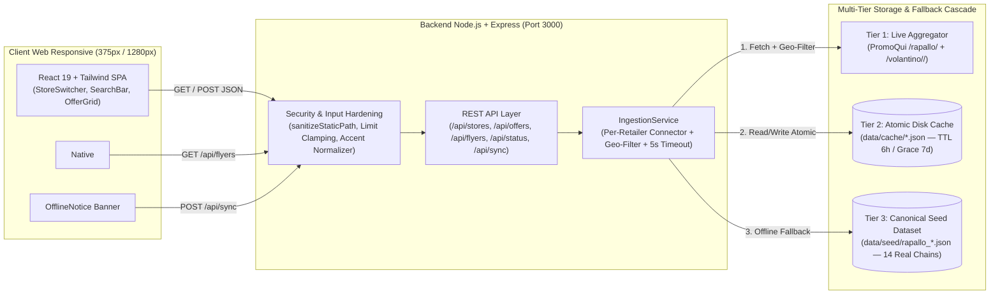

# Architecture Decision Records (ADR) & Master Task Backlog — Basilico

Questa cartella raccoglie gli **Architecture Decision Records (ADR)** e il **Backlog Operativo** del progetto **Basilico — Offerte e Volantini Supermercati e Negozi di Rapallo (GE)** (`Noobucodonosor/basilico`), consolidando le decisioni architetturali, di sicurezza/hardening, di interfaccia utente e di fedeltà territoriale dei dati.

---

## Indice degli ADR

| ID | Titolo | Stato | Priorità | Autori / Fonti |
| :--- | :--- | :--- | :--- | :--- |
| **[ADR-0001](./0001-core-architecture.md)** | Architettura Core, Stack Tecnologico e Modello Dati Multi-Tier (Live → Cache → Seed) | Accettato (Baseline) | **P1 — Alta** | Team Basilico / `PROJECT.md` |
| **[ADR-0002](./0002-security-input-hardening.md)** | Sicurezza HTTP, Protezione Path Traversal, Input Hardening e Sanitizzazione Ricerca | Accettato | **P0 — Critica** | Team Basilico / `TEST_READY.md` |
| **[ADR-0003](./0003-responsive-ui-flyer-viewer.md)** | Interfaccia Web Responsive (375px/1280px), Visualizzatore Volantini `<dialog>` e Resilienza Offline UI | Accettato | **P1 — Alta** | Team Basilico / `PROJECT.md` |
| **[ADR-0004](./0004-real-rapallo-stores-catalog.md)** | Catalogo Reale dei Punti Vendita di Rapallo (14 Insegne Verificate) e Filtro Anti-Rumore Geografico sui Volantini | Accettato | **P0 — Critica** | Direttore di Prodotto (@Noobucodonosor) |
| **[ADR-0005](./0005-deep-sync-and-operation-progress-dialog.md)** | Controlli Dual Sync (Aggiornamento Rapido vs Deep Sync 14 Insegne) e Finestra di Dialogo Informativa `<dialog>` sullo Stato delle Operazioni | Accettato | **P1 — Alta** | Direttore di Prodotto (@Noobucodonosor) |
| **[ADR-0006](./0006-honest-data-integrity-no-synthetic-fields.md)** | Integrità Assoluta del Dato (Zero Dati Inventati su Prezzi, Sconti, Scadenze, Pagine e Filtro Geografico) | Accettato | **P0 — Critica** | Direttore di Prodotto (@Noobucodonosor) / Audit @cfiorentinoc-bot |

---

## Diagramma Architetturale del Sistema

---

## Master Task Backlog (Tutti i Task Censiti)

> **Nota:** Lo stato live (`Open` / `Closed`) di ciascun task è tracciato sulle **GitHub Issues** del repository `Noobucodonosor/basilico`. Usa `closes #<NumeroIssue>` nei commit per chiuderle automaticamente.

| Task ID | Issue | ADR | Titolo Task | File Coinvolti | Priorità | Assegnatari |
| :--- | :--- | :--- | :--- | :--- | :--- | :--- |
| **TASK-CORE-01** | `#1` | [ADR-0001](./0001-core-architecture.md) / [ADR-0004](./0004-real-rapallo-stores-catalog.md) | Allineamento Dataset Seed Reale di Rapallo (14 insegne verificate, indirizzi reali, rimozione Conad/Doro/Kasanova) e isolamento `data/cache/` | `data/seed/rapallo_*.json`, `.gitignore` | **P0 — Critica** | Team |
| **TASK-CORE-02** | `#2` | [ADR-0001](./0001-core-architecture.md) | Allineamento fallback `IngestionService` su errori di rete, timeout e deduplicazione `sync()` | `server/services/ingestionService.js` | **P1 — Alta** | Team |
| **TASK-SEC-01** | `#3` | [ADR-0002](./0002-security-input-hardening.md) | Hardening Clamping Paginazione (`limit` 1..100) e Normalizzazione Whitespace/Accenti in `OfferService` e `/api/offers` | `server/services/offerService.js`, `server/routes/offers.js`, `server/services/ingestionService.js` | **P0 — Critica** | Team |
| **TASK-UI-01** | `#4` | [ADR-0003](./0003-responsive-ui-flyer-viewer.md) | Allineamento Build Produzione (`dist/`), Viewport Meta e Verifica E2E Completa | `index.html`, `dist/index.html`, `src/index.css`, `server.js` | **P1 — Alta** | Team |
| **TASK-DATA-01** | `#5` | [ADR-0004](./0004-real-rapallo-stores-catalog.md) | Implementazione Connettore Per-Insegna (`/rapallo/<slug>`), Filtro Anti-Rumore Geografico sui Volantini e Allineamento Oracoli Test | `server/services/ingestionService.js`, `src/components/StoreSwitcher.jsx`, `tests/` | **P0 — Critica** | Team |
| **TASK-SYNC-01** | `#6` | [ADR-0005](./0005-deep-sync-and-operation-progress-dialog.md) | Pulsante Deep Sync 14 Negozi, Endpoint Telemetria `/api/sync/progress` e Finestra di Dialogo Informativa `<dialog>` (`SyncStatusModal`) | `server/services/ingestionService.js`, `server/routes/status.js`, `src/components/Header.jsx`, `src/components/SyncStatusModal.jsx`, `src/hooks/useSupermarketData.js`, `src/App.jsx` | **P1 — Alta** | Team |
| **TASK-DATA-02** | `#7` | [ADR-0006](./0006-honest-data-integrity-no-synthetic-fields.md) | Rimozione Dati Sintetici (Prezzi Originali `×1.25`, Scadenze Prorogate, Limite 25 Offerte, `unitPrice` Fittizio, Fallback Fuori Provincia) e Rigenerazione Pulita del Dataset Seed | `server/services/ingestionService.js`, `data/seed/rapallo_*.json`, `src/components/OfferCard.jsx`, `tests/` | **P0 — Critica** | Team |
