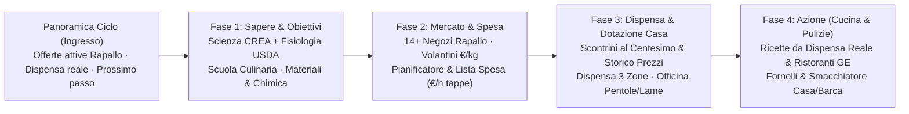

# Architecture Decision Records (ADR) & Master Task Backlog — Basilico

Questa cartella raccoglie gli **Architecture Decision Records (ADR)** e il **Backlog Operativo** del progetto **Basilico — Sistema Domestico, Nutrizionale, Gastronomico e Catalogo Offerte di Rapallo (GE)** (`Noobucodonosor/basilico`), consolidando le decisioni architetturali, di sicurezza/hardening, di interfaccia utente, di fedeltà territoriale dei dati e l'evoluzione modulare **Bottom-Up fino al Motore Causale "Le 5 Anime" sui 3 Ritmi e 7 Stanze dell'Atlante**.

---

## Indice degli ADR

| ID | Titolo | Stato | Priorità | Autori / Fonti |
| :--- | :--- | :--- | :--- | :--- |
| **[ADR-0001](./0001-core-architecture.md)** | Architettura Core, Stack Tecnologico e Modello Dati Multi-Tier (Live → Cache → Seed) | Accettato (Baseline) | **P1 — Alta** | Team Basilico / `PROJECT.md` |
| **[ADR-0002](./0002-security-input-hardening.md)** | Sicurezza HTTP, Protezione Path Traversal, Input Hardening e Sanitizzazione Ricerca | Accettato | **P0 — Critica** | Team Basilico / `TEST_READY.md` |
| **[ADR-0003](./0003-responsive-ui-flyer-viewer.md)** | Interfaccia Web Responsive (375px/1280px), Visualizzatore Volantini `<dialog>` e Resilienza Offline UI | Accettato | **P1 — Alta** | Team Basilico / `PROJECT.md` |
| **[ADR-0004](./0004-real-rapallo-stores-catalog.md)** | Catalogo Reale dei Punti Vendita di Rapallo (14 Insegne Verificate) e Filtro Anti-Rumore Geografico sui Volantini | Accettato | **P0 — Critica** | Direttore di Prodotto (@Noobucodonosor) |
| **[ADR-0005](./0005-deep-sync-and-operation-progress-dialog.md)** | Controlli Dual Sync (Aggiornamento Rapido vs Deep Sync 14 Insegne) e Finestra di Dialogo Informativa `<dialog>` sullo Stato delle Operazioni | Accettato | **P1 — Alta** | Direttore di Prodotto (@Noobucodonosor) |
| **[ADR-0006](./0006-honest-data-integrity-no-synthetic-fields.md)** | Integrità Assoluta del Dato (Zero Dati Inventati su Prezzi, Sconti, Scadenze, Pagine e Filtro Geografico) | Accettato | **P0 — Critica** | Direttore di Prodotto (@Noobucodonosor) / Audit @cfiorentinoc-bot |
| **[ADR-0007](./0007-multi-domain-catalog-unit-pricing-and-user-profiles.md)** | **Milestone 1 (Livelli 0–1):** Fondamenta Multi-Dominio (5 Domini Chiusi), Normalizzatore Prezzi Edibili (`€/kg`), Storico Prezzi & Profilo Utente Universale a 6 Stanze | Accettato | **P0 — Critica** | Direttore di Prodotto (@Noobucodonosor) |
| **[ADR-0008](./0008-crea-scientific-nutrition-engine-and-nutrients-per-euro.md)** | **Milestone 2 (Stanza 2):** Database Scientifico CREA al 100% (832 Alimenti × 7 Sezioni), Rese Crudo↔Cotto & Ponte "Nutrienti per Euro Edibili" | Accettato | **P1 — Alta** | Direttore di Prodotto (@Noobucodonosor) |
| **[ADR-0009](./0009-receipt-cent-reconciliation-and-three-zone-pantry.md)** | **Milestone 3 (Stanza 5):** Acquisizione Scontrini con Quadratura al Centesimo, Storico Prezzi Fuori Offerta & Dispensa Fisica a 3 Luoghi (Casa, Frigo, Barca) | Accettato | **P1 — Alta** | Direttore di Prodotto (@Noobucodonosor) |
| **[ADR-0010](./0010-kitchen-equipment-roi-and-cleaning-chemistry-reset.md)** | **Milestone 4 (Stanza 4):** Inventario Fisico della Cucina (Fornelli, Pentole & ROI Sblocco Piatti) e Protocollo Chimico "Kitchen Reset" (Sinergia Tigotà / PiùMe) | Accettato | **P1 — Alta** | Direttore di Prodotto (@Noobucodonosor) |
| **[ADR-0011](./0011-recipes-tigullio-restaurants-arbitrage-and-science-cooking-coach.md)** | **Milestone 5 (Stanza 3):** Ricette Quotidiane, Ristoranti del Tigullio & Stellati (BOM + Arbitraggio Live + 80/20) e Scuola di Cucina Scientifica ("Harvard Science & Cooking" + Quaderno Lab) | Accettato | **P1 — Alta** | Direttore di Prodotto (@Noobucodonosor) |
| **[ADR-0012](./0012-zero-waste-whole-pack-meal-planner-and-multi-store-shopping-list.md)** | **Milestone 6 (Stanza 6):** Pianificatore Settimanale "Neo-Dieta" a Confezioni Intere Zero-Spreco & Lista della Spesa Smart Multi-Negozio a Rapallo | Accettato | **P1 — Alta** | Direttore di Prodotto (@Noobucodonosor) |
| **[ADR-0013](./0013-product-realism-culinary-granularity-and-cross-room-coherence.md)** | **Maturazione Prodotto Finito (Stanze 1–6):** Realismo Prezzi/Domini, Conversione FAO Omega-3 CREA, Ricettario & Matcher Rigoroso, ROI Pentole/Scontrini & Solver Dieta Anti-Monotonia | Accettato | **P0 — Critica** | Direttore di Prodotto (@Noobucodonosor) |
| **[ADR-0014](./0014-ai-native-product-engineering-specs-evals-agentation-and-board.md)** | **Stack AI-Native Product Engineering:** Living Specs (`specs/`), Domain Evals (`evals/`), Visual Point-to-Agent (`Agentation`) & GitHub State Machine | Accettato | **P0 — Critica** | Direttore di Prodotto (@Noobucodonosor) |
| **[ADR-0015](./0015-five-souls-causal-engine-three-rhythms-and-grounded-maestro.md)** | **Basilico 2.0 ("Le 5 Anime"):** Motore Causale Dual-Layer, 5 Motori Scientifici Deterministici, Separazione Stanza 4 / Stanza 7 & Chat Grounded Maestro *(§2.2 UI superata da ADR-0016)* | Accettato (Parz. superato) | **P0 — Critica** | Direttore di Prodotto (@Noobucodonosor) |
| **[ADR-0016](./0016-causal-cycle-ontology-and-github-token-governance.md)** | **Ontologia a 4 Fasi del Ciclo Causale & Governance Token GitHub:** Rimozione Doppia Barra Oggi/Regia, Restyling Integrale per Fasi & Contabilità Token per Task (`TOKEN_LEDGER.md`) | Accettato | **P0 — Critica** | Direttore di Prodotto (@Noobucodonosor) |
| **[ADR-0017](./0017-public-cloud-run-security-and-llm-guardrails.md)** | **Sicurezza Pubblica Cloud Run & Guardrail LLM:** Blocco `contextOverride` in prod, `x-goog-api-key`, limiti chat, rate limiter zero-deps & Security Headers | Accettato | **P0 — Critica** | Direttore di Prodotto (@Noobucodonosor) |
| **[ADR-0018](./0018-storage-abstraction-and-cloud-run-persistence.md)** | **Strategia Persistenza Cloud Run & Continuità Catalogo Offline:** Modello Dual-Mode Casa vs Demo Effimera & Telemetria `seedHealth` (`ADR-0006` compliant) | Accettato | **P1 — Alta** | Direttore di Prodotto (@Noobucodonosor) |

---

## Diagramma Architetturale — Ciclo Causale Domestico a 4 Fasi (`ADR-0016` + Motori `ADR-0015`)

---

## Master Task Backlog (Tutti i Task Censiti)

> **Nota:** Lo stato live (`Open` / `Closed`) di ciascun task è tracciato sulle **GitHub Issues** del repository `Noobucodonosor/basilico`. Usa `closes #<NumeroIssue>` nei commit per chiuderle automaticamente.

| Task ID | Issue | ADR | Titolo Task | File Coinvolti | Priorità | Assegnatari |
| :--- | :--- | :--- | :--- | :--- | :--- | :--- |
| **TASK-CORE-01** | `#1` | [ADR-0001](./0001-core-architecture.md) / [ADR-0004](./0004-real-rapallo-stores-catalog.md) | Allineamento Dataset Seed Reale di Rapallo (14 insegne verificate, indirizzi reali, rimozione Conad/Doro/Kasanova) e isolamento `data/cache/` | `data/seed/rapallo_*.json`, `.gitignore` | **P0 — Critica** | Team |
| **TASK-CORE-02** | `#2` | [ADR-0001](./0001-core-architecture.md) | Allineamento fallback `IngestionService` su errori di rete, timeout e deduplicazione `sync()` | `server/services/ingestionService.js` | **P1 — Alta** | Team |
| **TASK-SEC-01** | `#3` | [ADR-0002](./0002-security-input-hardening.md) | Hardening Clamping Paginazione (`limit` 1..100) e Normalizzazione Whitespace/Accenti in `OfferService` e `/api/offers` | `server/services/offerService.js`, `server/routes/offers.js`, `server/services/ingestionService.js` | **P0 — Critica** | Team |
| **TASK-UI-01** | `#4` | [ADR-0003](./0003-responsive-ui-flyer-viewer.md) | Allineamento Build Produzione (`dist/`), Viewport Meta e Verifica E2E Completa | `index.html`, `dist/index.html`, `src/index.css`, `server.js` | **P1 — Alta** | Team |
| **TASK-DATA-01** | `#5` | [ADR-0004](./0004-real-rapallo-stores-catalog.md) | Implementazione Connettore Per-Insegna (`/rapallo/<slug>`), Filtro Anti-Rumore Geografico sui Volantini e Allineamento Oracoli Test | `server/services/ingestionService.js`, `src/components/StoreSwitcher.jsx`, `tests/` | **P0 — Critica** | Team |
| **TASK-SYNC-01** | `#6` | [ADR-0005](./0005-deep-sync-and-operation-progress-dialog.md) | Pulsante Deep Sync 14 Negozi, Endpoint Telemetria `/api/sync/progress` e Finestra di Dialogo Informativa `<dialog>` (`SyncStatusModal`) | `server/services/ingestionService.js`, `server/routes/status.js`, `src/components/Header.jsx`, `src/components/SyncStatusModal.jsx`, `src/hooks/useSupermarketData.js`, `src/App.jsx` | **P1 — Alta** | Team |
| **TASK-DATA-02** | `#7` | [ADR-0006](./0006-honest-data-integrity-no-synthetic-fields.md) | Rimozione Dati Sintetici (Prezzi Originali `×1.25`, Scadenze Prorogate, Limite 25 Offerte, `unitPrice` Fittizio, Fallback Fuori Provincia) e Rigenerazione Pulita del Dataset Seed | `server/services/ingestionService.js`, `data/seed/rapallo_*.json`, `src/components/OfferCard.jsx`, `tests/` | **P0 — Critica** | Team |
| **TASK-M1-01** | `#9` | [ADR-0007](./0007-multi-domain-catalog-unit-pricing-and-user-profiles.md) | Estensione Anagrafica Negozi Rapallo (6 Categorie, Logistica, Carte Fedeltà), Classificatore a 5 Domini Chiusi, Normalizzatore `€/kg` Edibile e Lente Qualità Scientifica | `data/seed/rapallo_stores.json`, `server/services/domainClassifier.js`, `server/services/unitPriceExtractor.js`, `server/services/qualityLensService.js`, `server/services/offerService.js`, `tests/unit/domain_and_units.test.js` | **P0 — Critica** | Team |
| **TASK-M1-02** | `#10` | [ADR-0007](./0007-multi-domain-catalog-unit-pricing-and-user-profiles.md) | Storico Prezzi Osservati ("È un vero sconto?"), Inserimento Prezzo al Banco, Profili Utente Multipli con Esclusioni a 4 Livelli e Shell UI a 6 Stanze | `server/services/priceHistoryService.js`, `server/services/userProfileService.js`, `server/routes/profiles.js`, `server/routes/prices.js`, `src/App.jsx`, `src/components/Header.jsx`, `src/components/OfferCard.jsx`, `tests/api/profiles_and_prices.test.js` | **P0 — Critica** | Team |
| **TASK-M2-01** | `#11` | [ADR-0008](./0008-crea-scientific-nutrition-engine-and-nutrients-per-euro.md) | Estrazione Seed Certificato CREA (832 Alimenti × 26.622 Valori in 7 Sezioni + Rese Crudo/Cotto) e Servizio Backend `CreaService` + `CreaOfferMatcher` (Head-Noun & Nutrienti/€ Edibili) | `data/seed/crea_foods.json`, `data/seed/crea_yields.json`, `server/services/creaService.js`, `server/services/creaOfferMatcher.js`, `server/routes/crea.js`, `tests/unit/crea_service.test.js`, `tests/api/crea_api.test.js` | **P1 — Alta** | Team |
| **TASK-M2-02** | `#12` | [ADR-0008](./0008-crea-scientific-nutrition-engine-and-nutrients-per-euro.md) | Interfaccia Completa Stanza 2 ("Scienza & CREA"): Scheda Accademica a 7 Sezioni, Switch 100g/Lordo/LARN/Crudo↔Cotto, Confronto Side-by-Side e Classifica Live "Nutrienti per Euro" + Ponte Bidirezionale Stanza 1 | `src/components/crea/CreaExplorerView.jsx`, `src/components/crea/CreaFoodModal.jsx`, `src/components/crea/CreaCompareTray.jsx`, `src/components/OfferCard.jsx`, `src/App.jsx`, `tests/e2e/crea_ui.test.js` | **P1 — Alta** | Team |
| **TASK-M3-01** | `#13` | [ADR-0009](./0009-receipt-cent-reconciliation-and-three-zone-pantry.md) | Motore Scontrini con Quadratura Obbligatoria al Centesimo, Alimentazione Automatica Prezzi Fuori Offerta e Servizio Dispensa a 3 Luoghi (`dry_pantry`, `fridge_freezer`, `boat_cooler`) con Finestra $T_{\text{open}}$ | `server/services/receiptService.js`, `server/services/pantryService.js`, `server/routes/receipts.js`, `server/routes/pantry.js`, `tests/unit/receipt_reconciliation.test.js`, `tests/api/pantry_and_receipts.test.js` | **P1 — Alta** | Team |
| **TASK-M3-02** | `#14` | [ADR-0009](./0009-receipt-cent-reconciliation-and-three-zone-pantry.md) | Interfaccia Completa Stanza 5 ("Dispensa & Scontrini"): Scanner/Editor Scontrino con Controllo Centesimi, Vista 3 Luoghi (Secca / Frigo / Barca), Alert Freschi Aperti e Controlli Rapidi Scorte | `src/components/pantry/PantryAndReceiptsView.jsx`, `src/components/pantry/ReceiptScannerModal.jsx`, `src/App.jsx`, `tests/e2e/pantry_receipts_ui.test.js` | **P1 — Alta** | Team |
| **TASK-M4-01** | `#15` | [ADR-0010](./0010-kitchen-equipment-roi-and-cleaning-chemistry-reset.md) | Seed Archetipi Pentole & Chimica Detergenza, `KitchenInventoryService` (Compatibilità Induzione/Gas & Calcolo ROI Piatti Sbloccati) e `KitchenResetService` (Abbinamento Live Offerte Tigotà/PiùMe) | `data/seed/cookware_archetypes.json`, `data/seed/cleaning_chemistry.json`, `server/services/kitchenInventoryService.js`, `server/services/kitchenResetService.js`, `server/routes/kitchen.js`, `tests/unit/kitchen_services.test.js` | **P1 — Alta** | Team |
| **TASK-M4-02** | `#16` | [ADR-0010](./0010-kitchen-equipment-roi-and-cleaning-chemistry-reset.md) | Interfaccia Completa Stanza 4 ("Cucina, Pentole & Pulizia"): Configuratore Piano Cottura, Cassetto Pentole con ROI Sblocco, Sottolavello e Guida Interattiva "Kitchen Reset" con Offerte Tigotà/PiùMe | `src/components/kitchen/KitchenCareView.jsx`, `src/components/kitchen/KitchenResetCard.jsx`, `src/App.jsx`, `tests/e2e/kitchen_care_ui.test.js` | **P1 — Alta** | Team |
| **TASK-M5-01** | `#17` | [ADR-0011](./0011-recipes-tigullio-restaurants-arbitrage-and-science-cooking-coach.md) | Importazione Seed Certificato (Ricette Base Single + 32 Ristoranti Tigullio con 1.134 righe BOM + Stellati), Motore Doppio Costo / Arbitraggio Live, Varianti Automatiche Profilo e Solver 80/20 Max-Coverage | `data/seed/recipes_and_dishes.json`, `data/seed/restaurants_tigullio.json`, `server/services/recipeAndArbitrageService.js`, `server/routes/recipes.js`, `tests/unit/recipe_arbitrage_8020.test.js`, `tests/api/recipes_api.test.js` | **P1 — Alta** | Team |
| **TASK-M5-02** | `#18` | [ADR-0011](./0011-recipes-tigullio-restaurants-arbitrage-and-science-cooking-coach.md) | Interfaccia Completa Stanza 3 ("Ricette, Ristoranti & Fornelli"): Catalogo con Arbitraggio & Vista 80/20, Modalità Fornelli a Schermo Intero (*Science & Cooking* + Timer + Kitchen Reset) e Quaderno di Laboratorio | `src/components/recipes/RecipesAndRestaurantsView.jsx`, `src/components/recipes/CookingModeModal.jsx`, `src/components/recipes/LabNotebookModal.jsx`, `src/App.jsx`, `tests/e2e/recipes_cooking_ui.test.js` | **P1 — Alta** | Team |
| **TASK-M6-01** | `#19` | [ADR-0012](./0012-zero-waste-whole-pack-meal-planner-and-multi-store-shopping-list.md) | Servizio `MealPlannerService` (6 Modelli Neo-Dieta, Giorni Barca/Terra, Priorità Freschi Aperti, Concatenazione Confezioni Intere Zero-Spreco e Budget Onesto) e `ShoppingListService` (Simulatore 1/2/3 Negozi Rapallo, Corsie & Piano B) | `server/services/mealPlannerService.js`, `server/services/shoppingListService.js`, `server/routes/planner.js`, `server/routes/shoppingList.js`, `tests/unit/meal_planner_zero_waste.test.js`, `tests/api/planner_and_shopping_list.test.js` | **P1 — Alta** | Team |
| **TASK-M6-02** | `#20` | [ADR-0012](./0012-zero-waste-whole-pack-meal-planner-and-multi-store-shopping-list.md) | Interfaccia Completa Stanza 6 ("Pianificatore & Lista Spesa"): Selettore 6 Modelli, Calendario Barca/Terra con Tracciabilità Confezioni, Simulatore Multi-Negozio, Modalità "In Corsia" ed Export WhatsApp/Telegram | `src/components/planner/PlannerAndShoppingView.jsx`, `src/components/planner/AisleChecklistModal.jsx`, `src/App.jsx`, `tests/e2e/planner_shopping_ui.test.js` | **P1 — Alta** | Team |
| **TASK-REAL-01** | `#21` | [ADR-0013](./0013-product-realism-culinary-granularity-and-cross-room-coherence.md) | Hardening Domini/Categorie, Formato Tipico Trasparente per Prezzi/CREA, Fix Conversione FAO Omega-3 & Paginazione Stanza 2 | `server/services/domainClassifier.js`, `server/services/unitPriceExtractor.js`, `server/services/offerService.js`, `server/services/priceHistoryService.js`, `server/services/creaService.js`, `server/services/creaOfferMatcher.js`, `src/components/crea/CreaExplorerView.jsx`, `tests/unit/crea_service.test.js` | **P0 — Critica** | Team |
| **TASK-REAL-02** | `#22` | [ADR-0013](./0013-product-realism-culinary-granularity-and-cross-room-coherence.md) | Espansione Catalogo Ricette (Scuola Base Single, Colazioni Reali, Cambusa Fredda Barca), Tassonomia `dishFamily` e Deduplica Comparativa Ristoranti | `data/seed/recipes_and_dishes.json`, `server/services/recipeAndArbitrageService.js`, `src/components/recipes/RecipesAndRestaurantsView.jsx`, `tests/unit/recipe_arbitrage_8020.test.js` | **P1 — Alta** | Team |
| **TASK-REAL-03** | `#23` | [ADR-0013](./0013-product-realism-culinary-granularity-and-cross-room-coherence.md) | Matcher Semantico Rigoroso BOM↔Offerte, Formati Confezione Reali, Politica `Zero Formaggi` a 3 Livelli & 8 Archetipi *Science & Cooking* | `server/services/recipeAndArbitrageService.js`, `src/components/recipes/RecipesAndRestaurantsView.jsx`, `src/components/recipes/CookingModeModal.jsx`, `tests/unit/recipe_arbitrage_8020.test.js` | **P0 — Critica** | Team |
| **TASK-REAL-04** | `#24` | [ADR-0013](./0013-product-realism-culinary-granularity-and-cross-room-coherence.md) | Allineamento ID Pentole con ROI Dinamico Reale, Matching Chimico + Matrice Sicurezza P0 Sottolavello, Parser Scontrini Reale & Scarico Post-Cottura Dispensa | `server/services/kitchenInventoryService.js`, `server/services/kitchenResetService.js`, `server/services/receiptService.js`, `server/services/pantryService.js`, `server/routes/pantry.js`, `src/components/kitchen/KitchenCareView.jsx`, `src/components/recipes/CookingModeModal.jsx`, `tests/unit/kitchen_services.test.js`, `tests/unit/receipt_reconciliation.test.js` | **P1 — Alta** | Team |
| **TASK-REAL-05** | `#25` | [ADR-0013](./0013-product-realism-culinary-granularity-and-cross-room-coherence.md) | Solver Settimanale *Neo-Dieta* Umano (Varietà, Colazioni Vere, Barca Sicura, Pranzo≠Cena), Vero Simulatore Multi-Negozio Rapallo, Piano B Semantico & `+ Lista` Cross-Room | `server/services/mealPlannerService.js`, `server/services/shoppingListService.js`, `src/App.jsx`, `src/components/Header.jsx`, `src/components/OfferCard.jsx`, `src/components/planner/PlannerAndShoppingView.jsx`, `tests/unit/meal_planner_zero_waste.test.js`, `tests/e2e/planner_shopping_ui.test.js` | **P0 — Critica** | Team |
| **TASK-REAL-06** | `#26` | [ADR-0013](./0013-product-realism-culinary-granularity-and-cross-room-coherence.md) | Hardening Stanza 1 (`Negozi & Offerte`): Crash Card Fedeltà, Paginazione Completa, Tassonomia Lessicale Rigorosa Dominio/Reparto, Lente Qualità Non-Food, Sfogliatore Volantino & Coerenza Contatori/Stato | `server/services/domainClassifier.js`, `server/services/ingestionService.js`, `server/services/unitPriceExtractor.js`, `server/services/qualityLensService.js`, `server/services/offerService.js`, `server/routes/stores.js`, `src/App.jsx`, `src/hooks/useSupermarketData.js`, `src/components/OfferGrid.jsx`, `src/components/OfferCard.jsx`, `src/components/StoreSwitcher.jsx`, `src/components/Header.jsx`, `src/components/FlyerModalCoordinator.js`, `src/components/FlyerModal.jsx`, `src/components/FlyerCarousel.jsx`, `tests/unit/domain_and_units.test.js` | **P0 — Critica** | Team |
| **TASK-AIENG-01** | `#27` | [ADR-0014](./0014-ai-native-product-engineering-specs-evals-agentation-and-board.md) | AI-Native Product Engineering Stack: Living Specs (`specs/`), Domain Evals Suite (`evals/`), `Agentation` Visual Point-to-Agent & GitHub Taste-Check Pipeline (`#28`..`#33`) | `specs/*.spec.md`, `evals/run_evals.mjs`, `server/routes/agentation.js`, `server/index.js`, `src/App.jsx`, `scripts/board.mjs`, `package.json`, `AGENTS.md` | **P0 — Critica** | Team |
| **TASK-AIENG-02** | `#34` | [ADR-0014](./0014-ai-native-product-engineering-specs-evals-agentation-and-board.md) | Audit Avversariale Autonomo 6 Stanze: Purificazione Tassonomia/Unieuro/CREA, Fix Michelin/80-20/Sottolavello/Piano B, UX Mobile 375px & Rubriche Anti-Regressione | `server/services/*.js`, `server/routes/crea.js`, `src/App.jsx`, `src/components/**`, `evals/run_evals.mjs` | **P1 — Alta** | Team |
| **TASK-DATA-03** | `#35` | [ADR-0006](./0006-honest-data-integrity-no-synthetic-fields.md) / [ADR-0007](./0007-multi-domain-catalog-unit-pricing-and-user-profiles.md) | Categorie Dedicate Extra-Casa (`bazar_seasonal`, Giocattoli/Natale, Tessile/Bazar, Pentole/Elettrodomestici, Animali), Verifica Territoriale GE/Rapallo su `storesData.stores` PromoQui (zero leak CZ/LT/RM + recupero redirect Penny/Unieuro), Trasparenza Cap 50 Offerte & UX Interattiva Botteghe/Sottolavello/Corsia | `server/services/domainClassifier.js`, `server/services/ingestionService.js`, `server/services/offerService.js`, `server/services/shoppingListService.js`, `src/App.jsx`, `src/components/**`, `specs/01-negozi.spec.md`, `evals/run_evals.mjs` | **P0 — Critica** | Team |
| **TASK-SWARM-01** | `#36` | [ADR-0013](./0013-product-realism-culinary-granularity-and-cross-room-coherence.md) / [ADR-0014](./0014-ai-native-product-engineering-specs-evals-agentation-and-board.md) | Risoluzione Integrale 39 Bug Verificati dallo Swarm (10 P0, 20 P1, 9 P2) sulle 6 Stanze: Protezione Cache/Input, Purezza Domini/CREA, Identità Zero-Formaggi & Chimica Rame/Gres, Persistenza Piano 21/21 & Hardening Evals | `server/services/*.js`, `server/routes/*.js`, `data/seed/{recipes_and_dishes,cookware_archetypes,cleaning_chemistry}.json`, `src/App.jsx`, `src/components/**`, `evals/run_evals.mjs`, `tests/**` | **P0 — Critica** | Team |
| **TASK-M5-03** | `#37` | [ADR-0006](./0006-honest-data-integrity-no-synthetic-fields.md) / [ADR-0011](./0011-recipes-tigullio-restaurants-arbitrage-and-science-cooking-coach.md) | Acquisizione Menu Pubblici Reali con Prezzi nel Tigullio (6 nuovi locali verificati, +104 piatti reali → 23/32 ristoranti attivi, 368 piatti, 1.797 BOM) e Filtro Esclusivo Ristoranti con Listino Verificato in Stanza 3 | `data/seed/recipes_and_dishes.json`, `data/seed/restaurants_tigullio.json`, `server/services/recipeAndArbitrageService.js`, `server/routes/recipes.js`, `src/components/recipes/RecipesAndRestaurantsView.jsx`, `specs/03-ricette.spec.md`, `evals/run_evals.mjs`, `tests/**` | **P1 — Alta** | Team |
| **TASK-M5-04** | `#38` | [ADR-0006](./0006-honest-data-integrity-no-synthetic-fields.md) / [ADR-0011](./0011-recipes-tigullio-restaurants-arbitrage-and-science-cooking-coach.md) | Espansione Ristoranti Verificati all'intera Provincia di Genova (GE, Zero Pizzerie) con Menu Pubblici Prezzati Reali e Filtro per Zone/Comuni in Stanza 3 | `data/seed/recipes_and_dishes.json`, `data/seed/restaurants_tigullio.json`, `server/services/recipeAndArbitrageService.js`, `server/routes/recipes.js`, `src/components/recipes/RecipesAndRestaurantsView.jsx`, `specs/03-ricette.spec.md`, `evals/run_evals.mjs`, `tests/**` | **P1 — Alta** | Team |
| **TASK-V2-01** | `#39` | [ADR-0015](./0015-five-souls-causal-engine-three-rhythms-and-grounded-maestro.md) | Fix P0 Detergenza/Inox/Tigotà e Motore Chimico Universale Casa/Barca (`homeChemistryService`) | `server/services/qualityLensService.js`, `server/services/domainClassifier.js`, `data/seed/home_chemistry_matrix.json`, `server/services/homeChemistryService.js`, `server/routes/homeChemistry.js`, `tests/unit/home_chemistry_v2.test.js` | **P0 — Critica** | Team |
| **TASK-V2-02** | `#40` | [ADR-0015](./0015-five-souls-causal-engine-three-rhythms-and-grounded-maestro.md) | Motore Termofisico Strumenti (`cookwarePhysicsEngine`) e Accademia Culinaria / SOS Fornelli (`culinaryAcademyService`) | `data/seed/materials_physics.json`, `data/seed/cookware_archetypes.json`, `data/seed/culinary_academy.json`, `server/services/cookwarePhysicsEngine.js`, `server/services/culinaryAcademyService.js`, `server/routes/academy.js`, `tests/unit/cookware_and_academy_v2.test.js` | **P0 — Critica** | Team |
| **TASK-V2-03** | `#41` | [ADR-0015](./0015-five-souls-causal-engine-three-rhythms-and-grounded-maestro.md) | Motore Fisiologia del Pasto Cotto (24+ nutrienti, ritenzione USDA, biodisponibilità Ca/Fe, RS3) e Coaching Adattivo (`nutritionPhysiologyService`) | `data/seed/nutrition_physiology_rules.json`, `server/services/nutritionPhysiologyService.js`, `server/routes/nutritionCoach.js`, `tests/unit/nutrition_physiology_v2.test.js` | **P1 — Alta** | Team |
| **TASK-V2-04** | `#42` | [ADR-0015](./0015-five-souls-causal-engine-three-rhythms-and-grounded-maestro.md) | Economia Domestica (`VaR_48h`, `w_t`, TCO, `€/h`) e Motore Ibrido `maestroCoachService` (Oggi Pareto + Chat Maestro Grounded) | `server/services/pantryService.js`, `server/services/householdEconomicsService.js`, `server/services/maestroCoachService.js`, `server/routes/maestro.js`, `tests/unit/economics_and_maestro_v2.test.js` | **P0 — Critica** | Team |
| **TASK-V2-05** | `#43` | [ADR-0015](./0015-five-souls-causal-engine-three-rhythms-and-grounded-maestro.md) | Integrazione API Backend, UI "3 Ritmi" (`⚡ Oggi`, `Regia Settimanale`, `Accademia & Atlante` a 7 Stanze) e `MaestroDrawer` Conversazionale | `server/index.js`, `server/services/recipeAndArbitrageService.js`, `src/App.jsx`, `src/components/Header.jsx`, `src/components/RoomNavigation.jsx`, `src/components/maestro/**`, `src/components/chemistry/HomeChemistryView.jsx`, `src/components/kitchen/KitchenCareView.jsx` | **P1 — Alta** | Team |
| **TASK-V2-06** | `#44` | [ADR-0015](./0015-five-souls-causal-engine-three-rhythms-and-grounded-maestro.md) | Estensione Suite `Domain Evals` (`npm run eval`), Test E2E/Integrazione e Verifica Pre-Release | `evals/run_evals.mjs`, `scripts/board.mjs`, `tests/api/**`, `tests/e2e/**` | **P0 — Critica** | Team |
| **TASK-V2-07** | `#45` | [ADR-0015](./0015-five-souls-causal-engine-three-rhythms-and-grounded-maestro.md) | Restyling Anti-Slop (`tasteskill 2.5`): Sistema Editoriale Caldo, Motion Layer, Fotografie Reali & Linguaggio Umano | `index.html`, `src/index.css`, `src/App.jsx`, `src/components/{Header,RoomNavigation}.jsx`, `src/components/{today,maestro,home,academy,crea}/**`, `server/services/maestroCoachService.js`, `public/assets/img/*`, `tests/e2e/v2_five_souls_ui.test.js`, `evals/run_evals.mjs` | **P1 — Alta** | Team |
| **TASK-GOV-01** | `#46` | [ADR-0016](./0016-causal-cycle-ontology-and-github-token-governance.md) | Infrastruttura Contabilità Token Reali (`transcript.jsonl`), `ADR-0016` Ontologia a 4 Fasi e Roadmap GitHub (`budget:S`) | `scripts/tokenLedger.mjs`, `scripts/board.mjs`, `evals/run_evals.mjs`, `server/services/offerService.js`, `package.json`, `docs/adr/{0016-*.md,TOKEN_LEDGER.md,README.md}`, `AGENTS.md`, `tests/unit/token_ledger.test.js`, `tests/integration/challenger_m2_stress.test.js` | **P0 — Critica** | Agente Singolo |
| **TASK-CICLO-01** | `#47` | [ADR-0016](./0016-causal-cycle-ontology-and-github-token-governance.md) | Nuova Navigazione Unica sulle 4 Fasi del Ciclo Causale e Panoramica d'Ingresso (rimozione doppia barra Oggi/Regia) (`budget:M`) | `src/App.jsx`, `src/components/RoomNavigation.jsx`, `src/components/Header.jsx`, `src/components/cycle/CycleOverviewView.jsx`, `tests/e2e/v2_five_souls_ui.test.js` | **P0 — Critica** | Agente Singolo |
| **TASK-CICLO-02** | `#48` | [ADR-0016](./0016-causal-cycle-ontology-and-github-token-governance.md) | Fase 1 "Sapere & Obiettivi": Restyling editoriale di Scienza & CREA e integrazione coerente con Obiettivi Nutrizionali e Scuola Culinaria (`budget:M`) | `src/components/crea/{CreaExplorerView,CreaFoodModal,CreaCompareTray,NutritionCoachPanel}.jsx`, `src/components/academy/CulinaryAcademyPanel.jsx` | **P1 — Alta** | Agente Singolo |
| **TASK-CICLO-03** | `#49` | [ADR-0016](./0016-causal-cycle-ontology-and-github-token-governance.md) | Fase 2 "Mercato & Spesa": Restyling editoriale profondo di Negozi & Offerte Rapallo e Pianificatore/Lista Spesa (con tappe `€/h`) (`budget:L`) | `src/components/{StoreSwitcher,SearchBar,CategoryFilters,OfferGrid,OfferCard}.jsx`, `src/components/planner/{PlannerAndShoppingView,AisleChecklistModal}.jsx` | **P1 — Alta** | Agente Singolo |
| **TASK-CICLO-04** | `#50` | [ADR-0016](./0016-causal-cycle-ontology-and-github-token-governance.md) | Fase 3 "Dispensa & Dotazione Casa": Restyling editoriale di Dispensa & Scontrini (storico prezzi) e Officina Strumenti (`budget:M`) | `src/components/pantry/{PantryAndReceiptsView,ReceiptScannerModal}.jsx`, `src/components/kitchen/KitchenCareView.jsx` | **P1 — Alta** | Agente Singolo |
| **TASK-CICLO-05** | `#51` | [ADR-0016](./0016-causal-cycle-ontology-and-github-token-governance.md) | Fase 4 "Azione: Cucina & Pulizie": Restyling editoriale di Ricette, Ristoranti GE & Fornelli (con proposte da dispensa reale) e Chimica Casa (`budget:L`) | `src/components/recipes/{RecipesAndRestaurantsView,CookingModeModal,LabNotebookModal}.jsx`, `src/components/home/HomeChemistryView.jsx` | **P1 — Alta** | Agente Singolo |
| **TASK-CICLO-06** | `#52` | [ADR-0016](./0016-causal-cycle-ontology-and-github-token-governance.md) | Pulizia codice superato (`Oggi/Regia` standalone), riallineamento Living Specs, Domain Evals e chiusura Milestone (`budget:S`) | `src/components/today/`, `specs/*.spec.md`, `evals/run_evals.mjs`, `tests/e2e/v2_five_souls_ui.test.js` | **P2 — Media** | Agente Singolo |
| **TASK-SEC-03** | `#56` | [ADR-0017](./0017-public-cloud-run-security-and-llm-guardrails.md) | Sicurezza Cloud Run & Guardrail LLM (`contextOverride` prod-block, `x-goog-api-key`, rate limiter, security headers) (`budget:S`) | `server/middleware/rateLimiter.js`, `server/routes/{maestro,status}.js`, `server/services/maestroCoachService.js`, `server/index.js` | **P0 — Critica** | Agente Singolo |
| **TASK-DATA-04** | `#60` | [ADR-0018](./0018-storage-abstraction-and-cloud-run-persistence.md) | Strategia Persistenza Cloud Run & Telemetria `seedHealth` Offline (`budget:S`) | `server/services/ingestionService.js`, `server/routes/status.js`, `tests/unit/seed_health_telemetry.test.js` | **P1 — Alta** | Agente Singolo |
